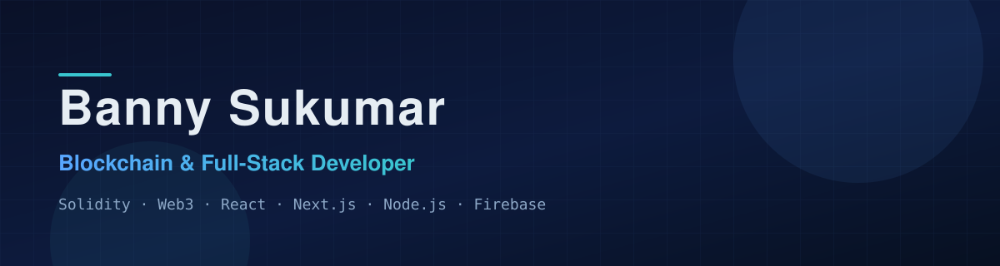
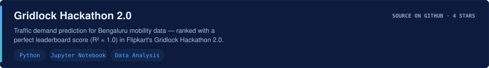
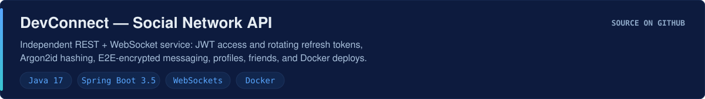
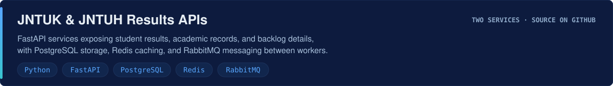
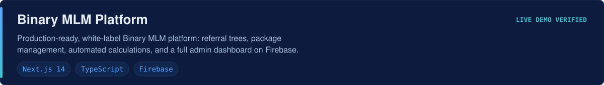
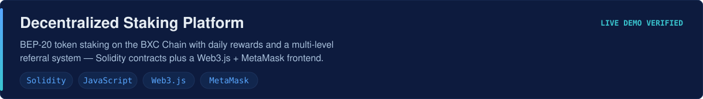
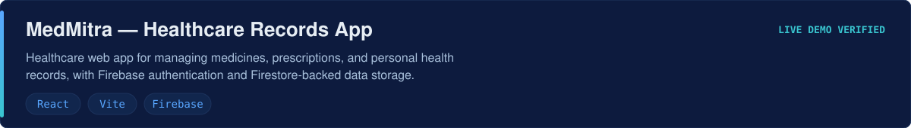

# Banny Sukumar

**Blockchain & Full-Stack Developer · Web3 · DApps · DeFi · Telegram Bots**

  
  
  
  
  

[About](#about-me) · [Tech Stack](#technology-stack) · [Selected Work](#selected-work) · [All Repositories](#repository-directory) · [Stats](#commit-log) · [Contact](#connect)

---

I'm a software developer focused on **Web3 engineering** and **full-stack product development**.

- **Smart contracts & dApps** — Solidity contracts and end-to-end decentralized apps on Ethereum
  and BNB Chain testnets: staking, token swaps, NFT marketplaces, insurance policies,
  lucky draws (Chainlink VRF), and intellectual-property registries.
- **Frontend engineering** — React, Next.js 14, Vite, and TypeScript applications with Firebase
  (Auth, Firestore, Storage, Functions) integration, deployed on Vercel.
- **Backend services** — FastAPI (Python) APIs with PostgreSQL, Redis, and RabbitMQ;
  Node.js services with Express; a Spring Boot 3.5 REST/WebSocket API with JWT auth,
  Argon2id hashing, and Docker deployment.
- **Automation** — Telegram bots (Telegraf), Telegram mini apps with TON Connect,
  WhatsApp tooling, and telephony automation on Asterisk PBX.
- **Mobile** — Android applications in Java and Expo/React Native apps.

Placed in hackathons (Flipkart Gridlock Hackathon 2.0, perfect leaderboard score) and
shipped dozens of production sites for colleges, businesses, and events.

---

  

  

  

  

| Category | Technologies |
|---|---|
| **Languages** | Solidity, TypeScript, JavaScript, Python, Java, C# |
| **Frontend** | React, Next.js 14, Vite, Tailwind CSS, HTML5, CSS3 |
| **Backend** | Node.js, Express, FastAPI, Spring Boot, Firebase Functions |
| **Databases** | PostgreSQL, Redis, MongoDB, Firebase Firestore |
| **Web3** | Ethers.js, Web3.js, MetaMask, Chainlink VRF, TON Connect, OpenZeppelin |
| **APIs & Auth** | REST APIs, JWT (access + refresh tokens), Argon2id, WebSockets, Razorpay, Cashfree |
| **Cloud & Deployment** | Vercel, Firebase Hosting, Docker, GitHub Actions |
| **Tools** | Git, GitHub, VS Code, Postman, Hardhat, Expo, Asterisk PBX |

---

  

  

  
  

  
  

  
  

  
  

---

All **98 public repositories** on this profile, grouped by category.
Each repository name links to its GitHub page; live demos were individually verified —
repositories with no verified deployment show only their source link.

## Blockchain, Web3 & Smart Contracts (26)

Show 26 repositories

| Repository | Description | Stack | Demo |
|---|---|---|---|
| [decentralized-staking](https://github.com/Bannysukumar/decentralized-staking) | Staking dApp on BXC Chain with daily rewards and multi-level referral system | Solidity · JS | [Live](https://decentralized-staking-bay.vercel.app) |
| [Decentralized-swaping-with-refferal](https://github.com/Bannysukumar/Decentralized-swaping-with-refferal) | BEP-20 token swap with incentivized referral system and first-swap bonus | Solidity · JS | [Live](https://decentralized-swaping-with-refferal.vercel.app) |
| [Decentralized-Insurance-Platform](https://github.com/Bannysukumar/Decentralized-Insurance-Platform) | On-chain insurance policy dApp (Sepolia testnet) | Solidity · JS | [Live](https://decentralized-insurance-platform.vercel.app) |
| [Intellectual-Property](https://github.com/Bannysukumar/Intellectual-Property) | dApp for registering, verifying, and transferring IP ownership on Ethereum (Sepolia) | Solidity · JS | [Live](https://intellectual-property-one.vercel.app) |
| [decentralized-staking-for-pranavam](https://github.com/Bannysukumar/decentralized-staking-for-pranavam) | PRANA token staking dApp, contracts on BSC Testnet with auto network detection | Solidity · JS | [Live](https://pranavamai.vercel.app) |
| [lucky-draw](https://github.com/Bannysukumar/lucky-draw) | Decentralized lottery on BNB Chain using Chainlink VRF for randomness | Solidity · JS | — |
| [crypto-pay](https://github.com/Bannysukumar/crypto-pay) | INR-Crypto payment contracts (BXCToken, CryptoWallet) with web frontend | Solidity · JS | — |
| [Crypto-Exchange](https://github.com/Bannysukumar/Crypto-Exchange) | CryptoPay React app for INR and crypto payments with Cashfree, Firebase, web3 | React · TS | [Live](https://crypto-exchange-ecru-chi.vercel.app) |
| [Decentralized-Nft-Market-Place](https://github.com/Bannysukumar/Decentralized-Nft-Market-Place) | NFT marketplace: mint, list, and trade NFTs via MetaMask | Solidity · JS | — |
| [Decentralized-Nft](https://github.com/Bannysukumar/Decentralized-Nft) | NFT minting dApp with ERC-721 contract and web frontend | Solidity · JS | — |
| [Nft-Metaweb3](https://github.com/Bannysukumar/Nft-Metaweb3) | Browser NFT marketplace page with ERC-721 marketplace contract (ethers.js) | Solidity · JS | — |
| [open-sea-clone](https://github.com/Bannysukumar/open-sea-clone) | OpenSea-style NFT marketplace built with Solidity and vanilla JS | Solidity · JS | — |
| [Decentralized-staking-DApp](https://github.com/Bannysukumar/Decentralized-staking-DApp) | Simple staking DApp with SimpleStaking/SimpleToken contracts and frontend | Solidity · JS | — |
| [Decentralized-Sip](https://github.com/Bannysukumar/Decentralized-Sip) | Decentralized Systematic Investment Plans using USDT and BXC tokens on BNB Chain | Solidity · TS | — |
| [decentralized-exchange](https://github.com/Bannysukumar/decentralized-exchange) | MYT/USDT token swap with TokenSwap contract and React frontend | Solidity · JS | — |
| [staking-website](https://github.com/Bannysukumar/staking-website) | React staking site with Lock.sol staking contract | Solidity · React | — |
| [pin-staking-website](https://github.com/Bannysukumar/pin-staking-website) | Staking platform landing ("Coming Soon") site | JS | — |
| [bluexcrypto.live--2-](https://github.com/Bannysukumar/bluexcrypto.live--2-) | BluEx DeFi staking platform with 8-level referral system | Solidity · JS | — |
| [bxc.network](https://github.com/Bannysukumar/bxc.network) | BXC Network web client | JS | — |
| [simple-storage-dapp](https://github.com/Bannysukumar/simple-storage-dapp) | Intro dApp: frontend to Ethereum contract via Web3.js and MetaMask | JS | — |
| [solidity-home-works-and-assements](https://github.com/Bannysukumar/solidity-home-works-and-assements) | Solidity exercises incl. OpenZeppelin upgradeable contract sources | Solidity | — |
| [IIT-KANPUR-ASSEMENT1](https://github.com/Bannysukumar/IIT-KANPUR-ASSEMENT1) | Pharma supply chain dApp (PharmaSupplyChain.sol + web UI) | Solidity · JS | — |
| [pin-token](https://github.com/Bannysukumar/pin-token) | Documentation repository for the PIN token project | Markdown | — |
| [bxc-mining-app](https://github.com/Bannysukumar/bxc-mining-app) | Documentation repository for the BXC mining app project | Markdown | — |
| [trustnft](https://github.com/Bannysukumar/trustnft) | Documentation repository for the TrustNFT project | Markdown | — |
| [Web3-Agency-Website](https://github.com/Bannysukumar/Web3-Agency-Website) | "Nexus Forge Web3" agency marketing site (static) | HTML · CSS · JS | — |

## MLM, Referral & Investment Platforms (10)

Show 10 repositories

| Repository | Description | Stack | Demo |
|---|---|---|---|
| [binary-mlm-plan](https://github.com/Bannysukumar/binary-mlm-plan) | White-label Binary MLM platform with referral trees and admin features | Next.js 14 · TS · Firebase | [Live](https://binary-mlm-plan-frontend.vercel.app) |
| [single-mlm-website](https://github.com/Bannysukumar/single-mlm-website) | Single-leg MLM platform with multiple income streams and automated calculations | React · Firebase | [Live](https://single-mlm-website.vercel.app) |
| [mlm-web](https://github.com/Bannysukumar/mlm-web) | MLM website with registration, package management, referrals, and admin panel | HTML · JS · Firebase | [Live](https://mlm-web-two.vercel.app) |
| [rich-pay-mlm-website](https://github.com/Bannysukumar/rich-pay-mlm-website) | Crypto investment and referral platform scaffold (black & gold theme) | React · Vite · Firebase | — |
| [malaysiantradenets.com-mlm-website](https://github.com/Bannysukumar/malaysiantradenets.com-mlm-website) | White-label MLM web app with marketing pages, user dashboard, and admin CMS | React · Firebase | — |
| [Telugu-Earning-Hub](https://github.com/Bannysukumar/Telugu-Earning-Hub) | Investment platform monorepo: React client + API for plans, deposits, referrals | React · TS · Node.js | — |
| [investment-plan-telugu-earning-hub](https://github.com/Bannysukumar/investment-plan-telugu-earning-hub) | pnpm workspace for the Telugu Earning Hub ROI app (client, API, mockups) | React · TS · Node.js | — |
| [trustnft.live](https://github.com/Bannysukumar/trustnft.live) | Investment platform with balance dashboard, recharge, withdrawal, and team pages | Firebase · HTML/JS | [Live](https://trustnft-live.vercel.app) |
| [kait.org](https://github.com/Bannysukumar/kait.org) | Admin console with user, KYC, withdrawal, wallet, and staking-plan screens | Next.js · TS | [Live](https://kait-org.vercel.app) |
| [mytree-website](https://github.com/Bannysukumar/mytree-website) | Climate-action site selling $MYTREE with Razorpay donations and dual referral rewards | Web app | — |

## Full-Stack & Web Applications (32)

Show 32 repositories

| Repository | Description | Stack | Demo |
|---|---|---|---|
| [e-commerce-website-build](https://github.com/Bannysukumar/e-commerce-website-build) | E-commerce site with account area and full admin CMS (orders, coupons, customers) | Next.js · TS | — |
| [PelliMandapam-website](https://github.com/Bannysukumar/PelliMandapam-website) | Wedding mandapam booking platform with comparison, booking, auth, and support | Next.js · TS | [Live](https://pelli-mandapam.vercel.app) |
| [Zivo-Academy-website](https://github.com/Bannysukumar/Zivo-Academy-website) | Academy platform with courses, cart, checkout, auth, and contact pages | Next.js · TS | — |
| [Trivexa-website](https://github.com/Bannysukumar/Trivexa-website) | Corporate site for Trivexa Technologies (blockchain development company) | Next.js · TS | [Live](https://trivexa-five.vercel.app) |
| [Terms-Website](https://github.com/Bannysukumar/Terms-Website) | Site for Tamizh Nadu Ecological Restoration Council (TERM) | Next.js · TS | [Live](https://terms-website.vercel.app) |
| [-CLAT-2K26-Fest](https://github.com/Bannysukumar/-CLAT-2K26-Fest) | College festival site with events, gallery, coordinators, and background video | Next.js · TS | [Live](https://eclat-2k26.vercel.app) |
| [Click-craze-affiliated-website](https://github.com/Bannysukumar/Click-craze-affiliated-website) | Deals, blog, and affiliate site with categories and disclosure pages | Next.js · TS | [Live](https://click-craze-one.vercel.app) |
| [jntuh-results-website](https://github.com/Bannysukumar/jntuh-results-website) | JNTUH results portal with academic resources and career sections | Next.js · TS | [Live](https://manajntuhresults.vercel.app) |
| [malla-reddy-women-s-engineering-results-website](https://github.com/Bannysukumar/malla-reddy-women-s-engineering-results-website) | Results portal: academic results, backlogs, credits, rankings, and analytics | Next.js · TS | [Live](https://malla-reddy-women-s-engineering-res.vercel.app) |
| [jntuk-website](https://github.com/Bannysukumar/jntuk-website) | JNTUK results site with academic result and backlog report pages | Next.js · TS | — |
| [dating-website](https://github.com/Bannysukumar/dating-website) | Anonymous video and text chat, no signup required | Next.js · TS | [Live](https://aura-chat-gray.vercel.app) |
| [Devbrain-ai-frentend](https://github.com/Bannysukumar/Devbrain-ai-frentend) | Dashboard unifying distributed technical knowledge via the Ragpi RAG backend API | Next.js · TS | [Live](https://devbrain-ai-frentend.vercel.app) |
| [Project](https://github.com/Bannysukumar/Project) | SLA dashboard with meter lists, data push/pull, and chart data | Next.js · TS | [Live](https://project-seven-ashy-32.vercel.app) |
| [portfolio-website](https://github.com/Bannysukumar/portfolio-website) | Personal portfolio site (adepu-sukumar.vercel.app) | Next.js · TS | [Live](https://adepu-sukumar.vercel.app) |
| [portfolio-website-](https://github.com/Bannysukumar/portfolio-website-) | Second portfolio site build | Vite · TS | — |
| [Mana-Code-Play-ground](https://github.com/Bannysukumar/Mana-Code-Play-ground) | Coding learning app with Monaco editor and Firebase integration | React · Vite · Firebase | [Live](https://mana-code-playground.vercel.app) |
| [MedMitra](https://github.com/Bannysukumar/MedMitra) | Healthcare app for medicines, prescriptions, and health records | React · Vite · Firebase | [Live](https://med-mitra-chi.vercel.app) |
| [My-World-website](https://github.com/Bannysukumar/My-World-website) | React version of the My World app website | React · JS | [Live](https://my-world-website.vercel.app) |
| [thanvish-travels](https://github.com/Bannysukumar/thanvish-travels) | React rewrite of the Thanvish Travels website | React | — |
| [thanvish.com](https://github.com/Bannysukumar/thanvish.com) | Static travel booking site for Thanvish Travels | HTML · CSS · JS | — |
| [travaling-website](https://github.com/Bannysukumar/travaling-website) | Travel booking site with admin panel for bookings, users, and packages | HTML · CSS · JS | [Live](https://travaling-website.vercel.app) |
| [spa-website](https://github.com/Bannysukumar/spa-website) | Static "N Wellness" spa site with services, about, and contact pages | HTML · CSS | [Live](https://spa-website-two.vercel.app) |
| [Akits-website](https://github.com/Bannysukumar/Akits-website) | Site for Abdul Kalam Institute of Technological Sciences (AKITS) | HTML · CSS | — |
| [1.-Cross-Platform-AI-Orchestration-Hub--AI-Blend-](https://github.com/Bannysukumar/1.-Cross-Platform-AI-Orchestration-Hub--AI-Blend-) | "AI Blend" static SaaS-style site: features, pricing, dashboard, accounts | HTML · CSS · JS | [Live](https://1-cross-platform-ai-orchestration-h.vercel.app) |
| [students-can-get-mentors](https://github.com/Bannysukumar/students-can-get-mentors) | "EduPlatform" mentoring landing page | HTML · CSS | — |
| [product](https://github.com/Bannysukumar/product) | Static shopping community with membership, referrals, partner shops, and admin | HTML · CSS · JS | — |
| [product-2](https://github.com/Bannysukumar/product-2) | Storefront scaffold with scripts and source in TypeScript | Next.js · TS | — |
| [Web3Todaywebsite](https://github.com/Bannysukumar/Web3Todaywebsite) | Workspace with Publications.app and web3today.io React clients | React · JS | — |
| [web3today](https://github.com/Bannysukumar/web3today) | Next.js landing page for QuickContracts.dev | Next.js · TS | — |
| [Typing-Master-app-website](https://github.com/Bannysukumar/Typing-Master-app-website) | Web version of the typing speed test app | JS | [Live](https://typing-master-taupe.vercel.app) |
| [nellore-diwali-dhamaka-website-](https://github.com/Bannysukumar/nellore-diwali-dhamaka-website-) | Campaign web app with Firebase backend, env-based config, and vitest suites | Vite · TS · Firebase | — |
| [SoundSpot-Website](https://github.com/Bannysukumar/SoundSpot-Website) | Song identification web app with favorites and listening history | React · JS | [Live](https://sound-spot-rust.vercel.app) |

## Backend, APIs & Services (4)

Show 4 repositories

| Repository | Description | Stack | Demo |
|---|---|---|---|
| [jntuk-backend](https://github.com/Bannysukumar/jntuk-backend) | FastAPI service for JNTUK results, academic records, and backlogs | Python · FastAPI · PostgreSQL · Redis · RabbitMQ | — |
| [jntuh-backend](https://github.com/Bannysukumar/jntuh-backend) | FastAPI service for JNTUH results, academic records, and backlogs | Python · FastAPI · PostgreSQL · Redis · RabbitMQ | — |
| [devbrain-ai-backend](https://github.com/Bannysukumar/devbrain-ai-backend) | RAG-based AI assistant answering questions from your documentation (Ragpi) | Python | — |
| [Developer-Social-Network](https://github.com/Bannysukumar/Developer-Social-Network) | Spring Boot REST + WebSocket API: JWT auth, Argon2id, encrypted messaging, Docker | Java · Spring Boot · Docker | — |

## Telegram Bots & Automation (5)

Show 5 repositories

| Repository | Description | Stack | Demo |
|---|---|---|---|
| [bot](https://github.com/Bannysukumar/bot) | Telegram bot with Express and Firebase integration | Node.js · Telegraf · Firebase | — |
| [Telegram-Mini-App](https://github.com/Bannysukumar/Telegram-Mini-App) | Telegram mini app with farming, tasks, game, wallet, and TON Connect | React · TON | — |
| [whatsapp-Bulk-messenger](https://github.com/Bannysukumar/whatsapp-Bulk-messenger) | WhatsApp bulk messaging, chatbot, and autoresponder platform | PHP · CodeIgniter 4 | [Live](https://whatsapp-bulk-messenger-two.vercel.app) |
| [instagram-whatsapp-paid-group](https://github.com/Bannysukumar/instagram-whatsapp-paid-group) | Group registration tool with Razorpay test payments and Playwright-assisted adds | Node.js · Playwright | — |
| [virtual-number](https://github.com/Bannysukumar/virtual-number) | Self-hosted virtual phone number system on Asterisk PBX with web admin | Shell · Asterisk PBX | — |

## Android & Mobile Apps (11)

Show 11 repositories

| Repository | Description | Stack | Demo |
|---|---|---|---|
| [Smart-News](https://github.com/Bannysukumar/Smart-News) | News app with login, comments, notifications, and an admin dashboard | Java · Firebase | — |
| [ERP-APP](https://github.com/Bannysukumar/ERP-APP) | Educational ERP app: Firebase, RFID/IoT, blockchain certificates, AR/VR labs | Java · Firebase | — |
| [freetesters](https://github.com/Bannysukumar/freetesters) | Android app-management utility (add app, profiles, policies, FAQs) | Java | — |
| [manavoori-muchhatlu-app](https://github.com/Bannysukumar/manavoori-muchhatlu-app) | Community posting app with admin, notifications, and profiles | Java | — |
| [BlueX](https://github.com/Bannysukumar/BlueX) | Android platform with KYC, admin panel, and withdrawal request management | Java | — |
| [Typing-Master](https://github.com/Bannysukumar/Typing-Master) | Android typing speed test (WebView wrapper around an HTML test) | Java · HTML | — |
| [PMATv](https://github.com/Bannysukumar/PMATv) | Live TV Android app with a separate admin-panel web project | Java | — |
| [PMTv](https://github.com/Bannysukumar/PMTv) | Second copy of the PMTv live TV app with its own admin panel | Java | — |
| [TrueBond](https://github.com/Bannysukumar/TrueBond) | Couples app with chat, connection flow, daily reports, and anniversary features | Java | — |
| [jntuh-results-app](https://github.com/Bannysukumar/jntuh-results-app) | Capacitor Android shell for JNTUH results, backlogs, and credit checker | Capacitor · HTML | — |
| [SoundSpot-App](https://github.com/Bannysukumar/SoundSpot-App) | Expo/React Native music app with components, constants, and shared logic | Expo · React Native · TS | — |

## Data Science, Developer Tools & Learning (5)

Show 5 repositories

| Repository | Description | Stack | Demo |
|---|---|---|---|
| [Gridlock-Hackathon-2.0](https://github.com/Bannysukumar/Gridlock-Hackathon-2.0) | Hackathon entry: Bengaluru traffic demand prediction (perfect leaderboard score) | Python · Jupyter | — |
| [Extension-Security-Inspector](https://github.com/Bannysukumar/Extension-Security-Inspector) | VS Code extension inspecting installed extension metadata and security indicators | TypeScript · VS Code API | — |
| [Dotnet-Learning](https://github.com/Bannysukumar/Dotnet-Learning) | C# practice and .NET 8 console project (operators, loops, tuples, converter) | C# · .NET 8 | — |
| [Pratice](https://github.com/Bannysukumar/Pratice) | Java practice notes | Java | — |
| [42-sms](https://github.com/Bannysukumar/42-sms) | Java app to send SMS messages via the FortyTwo API | Java | — |

## Forks (4)

Show 4 repositories

| Repository | Description | Status | Demo |
|---|---|---|---|
| [assets](https://github.com/Bannysukumar/assets) | Fork of Trust Wallet's crypto token asset list | Fork · Go | — |
| [Blockchain-Solidity](https://github.com/Bannysukumar/Blockchain-Solidity) | Fork of Bhanuprakash6248/Blockchain-Solidity | Fork · JS | — |
| [sample](https://github.com/Bannysukumar/sample) | Fork of Yasanga32/sample | Fork · CSS | — |
| [portfolio-security-service](https://github.com/Bannysukumar/portfolio-security-service) | Fork of a security-services company site (CCTV, personal & event security) | Fork · HTML | [Live](https://portfolio-security-service.vercel.app) |

## Profile Repository (1)

Show 1 repository

| Repository | Description |
|---|---|
| [Bannysukumar](https://github.com/Bannysukumar/Bannysukumar) | This GitHub profile repository (MIT licensed) |

---

<picture>
  <source media="(prefers-color-scheme: dark)" srcset="https://github-readme-stats.vercel.app/api?username=Bannysukumar&show_icons=true&include_all_commits=true&theme=github_dark&hide_border=true&bg_color=0D1117">
  
</picture>

<picture>
  <source media="(prefers-color-scheme: dark)" srcset="https://github-readme-stats.vercel.app/api/top-langs/?username=Bannysukumar&layout=compact&theme=github_dark&hide_border=true&bg_color=0D1117">
  
</picture>

---

---

## Open Source & License

This repository is open source and maintained by
[Banny Sukumar](https://github.com/Bannysukumar). These are the public open-source
projects of a blockchain and full-stack developer. Fork a repo and open a pull request.

Released under the [MIT License](LICENSE). See [CONTRIBUTING.md](CONTRIBUTING.md)
if you want to help.

